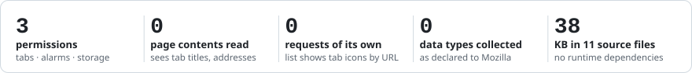

<!-- generated by scripts/readme/build.mjs. do not edit by hand. -->
# Tab Unloader

<picture>
<source media="(max-width: 500px) and (prefers-color-scheme: dark)" srcset="assets/readme/hero-narrow-dark.svg">
<source media="(max-width: 500px)" srcset="assets/readme/hero-narrow-light.svg">
<source media="(prefers-color-scheme: dark)" srcset="assets/readme/hero-dark.svg">

</picture>

A Firefox add-on that unloads tabs you have not looked at for a while (30 minutes by default). An unloaded tab keeps its place, title and icon in the tab strip, the page's memory is freed and it stops using CPU, and clicking the tab loads the page again. It uses Firefox's own tab-unloading mechanism, run on a timer.

Version 0.1.0 · Firefox 140 or later on desktop · not on addons.mozilla.org: [sign it yourself](#install), or try it now from about:debugging

[Install](#install) · [Using it](#using-it) · [Settings](#settings-page) · [Limits](#limits) · [Development](#development) · [Licence](#licence)

<picture>
<source media="(max-width: 500px) and (prefers-color-scheme: dark)" srcset="assets/readme/footprint-narrow-dark.svg">
<source media="(max-width: 500px)" srcset="assets/readme/footprint-narrow-light.svg">
<source media="(prefers-color-scheme: dark)" srcset="assets/readme/footprint-dark.svg">

</picture>

## Install

Release Firefox only installs add-ons that Mozilla has signed. For your own use, sign it as an unlisted add-on on addons.mozilla.org (AMO). Unlisted means Mozilla signs the file but does not publish it on AMO.

1. Create API credentials at https://addons.mozilla.org/developers/addon/api/key/.
2. In the shell you will sign from, set them for that session only. In PowerShell:

   ```powershell
   $env:WEB_EXT_API_KEY = "user:12345:67"
   $env:WEB_EXT_API_SECRET = "your secret"
   ```

   web-ext reads both variables itself. Do not write the credentials into a file in this repository.
3. Run `npm ci`, then `npm run sign`. Mozilla's automated check can take a few minutes or longer. The signed `.xpi` is saved in `web-ext-artifacts/`.
4. In Firefox, open about:addons, click the gear menu, choose "Install Add-on From File" and pick the `.xpi`.

AMO accepts each version number once. Before signing a changed add-on, raise `version` in `src/manifest.json`.

To use it in private windows: about:addons, click Tab Unloader, and set "Run in Private Windows" to Allow.

For development only, there are two ways to skip signing:

- Firefox ESR, Developer Edition and Nightly install unsigned add-ons when `xpinstall.signatures.required` is set to false in about:config. Build with `npm run build`, rename the `.zip` in `web-ext-artifacts/` to `.xpi` and install it the same way as above. Release Firefox ignores this setting.
- In any Firefox, about:debugging, This Firefox, "Load Temporary Add-on", then pick `src/manifest.json`. The add-on stays until Firefox restarts.

## Using it

### The toolbar button

Click the Tab Unloader button to open its list. It shows every tab in every normal Firefox window, grouped by window, with the window you opened it from marked "(current)". A filled or hollow dot shows whether each tab is loaded or unloaded, and the label on the right says "Unloaded", "Playing" (making sound) or "Current".

- Click a row to switch to that tab and bring its window to the front.
- Click the × on a row to unload that tab. If it is the tab on screen, Firefox cannot unload it, so the add-on first switches that window to the tab you used most recently (loaded tabs first) and then unloads it. The only tab in a window stays loaded.
- "Unload all others" unloads every tab except the current one, tabs playing sound, tabs using the camera, microphone or screen sharing, and tabs on the never-unload list. Pinned tabs are unloaded too. Firefox will not unload the tab on screen in another window, so those stay loaded. The status line says how many tabs were unloaded.
- "Never unload this site" adds the current tab's site to the never-unload list, using its full host name (for example `www.youtube.com`). To cover a site and all its subdomains, add the shorter name (`youtube.com`) on the settings page.
- "Never unload this page" adds the current tab's exact address.
- Both never-unload buttons are greyed out when the current tab is not an http or https page.
- "Pause auto-unload" stops automatic unloading until you clear it. The buttons in the list still work while paused.
- "Settings" opens the settings page.

### Automatic unloading

Once a minute the add-on checks every tab and unloads the ones you have not looked at for longer than the limit, 30 minutes by default. It skips a tab while:

- it is the tab on screen in its window
- it is pinned
- it is playing sound
- it is using the camera, microphone or screen sharing
- it matches the never-unload list

A skipped tab's idle time keeps counting. A tab you have not looked at for hours is unloaded at the first check after it stops playing sound or after you unpin it. Nothing is unloaded automatically while the add-on is paused.

### Seeing which tabs are unloaded

Firefox does not change how a tab looks when an add-on unloads it. The toolbar list always shows it, with a hollow dot and the label "Unloaded". To see it in the tab strip too, open about:config and set `browser.tabs.fadeOutUnloadedTabs` to true: the icons of unloaded tabs then fade to half strength, like the faded icons in the picture at the top.

When the computer wakes from sleep, a whole batch of tabs would be past the limit at once. To avoid that, if more than 3 minutes pass between two checks, the add-on unloads nothing on that check and restarts every tab's idle clock from that moment. Tabs are then unloaded one full limit after the wake, if you still have not looked at them.

## Settings page

Open it from the list's Settings link, or from Tab Unloader's entry in about:addons. It opens in a tab.

**Unload tabs after.** A whole number of minutes, 1 or more.

**Never unload.** Each entry is either a site name or a full page address.

- A site name keeps that site and all its subdomains loaded: `youtube.com` covers `www.youtube.com` and `music.youtube.com`. It matches http and https pages on any port. Type the name only, with no `https://`, path, port or `user@`. It needs at least one dot, except `localhost`. IPv4 addresses such as `192.168.1.10` work. Names are saved in lower case, and international names are saved in their `xn--` form.
- A full page address starts with `http://` or `https://` and keeps only that exact page loaded. The query string and `#` part must match too, so `https://example.com/inbox` does not cover `https://example.com/inbox?tab=2`.

Other kinds of address, such as `file:` or `about:` pages, cannot be added. Remove an entry with its Remove button. Changes made from the toolbar list show up on the settings page right away.

## Limits

- Firefox refuses to unload some tabs: some of its own about: pages, pages with an open dialog, and pages that would ask "Leave page?" before closing. Those tabs stay loaded.
- Unloading throws away whatever the page held in memory. Unsaved work in a web app, open connections such as chats or live feeds, and the position in a paused video can be lost. Put such sites on the never-unload list.
- Add-ons cannot read how much memory each tab uses, so the list shows no memory figures. about:processes shows them.
- Firefox's own unloading when the computer runs low on memory keeps working alongside this add-on.

## Development

The code is in `src/`. It needs Node.js and npm.

- `npm ci` installs the tools.
- `npm run lint` runs Mozilla's add-on linter on `src/`.
- `npm run build` packs `src/` into a `.zip` in `web-ext-artifacts/` (ignored by git), replacing an older one with the same version.
- `npm run readme` rebuilds this README and its pictures in `assets/readme/` from `src/` and `scripts/readme/body.md`. Edit those two, never `README.md`; a pull request with an out-of-date README fails CI.
- `npm run verify` runs the browser checks in order (smoke, options, popup, auto, restart, cleanup) and stops at the first failure. Each one also runs alone as `npm run verify:smoke`, `verify:options`, `verify:popup`, `verify:auto`, `verify:restart` or `verify:cleanup`.

The verify scripts start real Firefox windows with the add-on loaded as a temporary add-on, place them off screen at -2400,-2400 and set the volume to zero. They use Firefox at `C:\Program Files\Mozilla Firefox\firefox.exe`; set `FIREFOX_BINARY` to use another copy. The first run downloads geckodriver 0.37.1 into the system temp folder, so it needs a network connection. Screenshots go to `D:\screenshots\Firefox-Efficient\`, or to `.tmp\screenshots\` when D: is not writable. Each script prints a JSON line with its results last and exits with code 0 only when every check passes. The restart check unloads tabs, quits Firefox, starts it again on the same profile, and checks that every unloaded tab and a new tab load without the "tab crashed" page; it does this with the add-on installed temporarily, installed permanently, and not installed. To test a Firefox update, point `FIREFOX_BINARY_BEFORE` at an older Firefox: the first half then runs on that copy and the second half on the installed one. The cleanup check makes the test harness fail or hang on purpose in four ways and checks that each run still ends its own Firefox, geckodriver and helper processes, deletes its temporary profile, and leaves other processes alone.

## Licence

This repository does not have a licence file yet.
